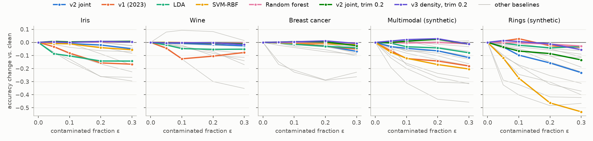

# kohonen-da

Reproduction (and, later, extensions) of

> Komarov I.V., Kuravsky L.S. **Discriminant Analysis Based on Kohonen Statistics.**
> *Modelling and Data Analysis*, 2023, 13(4), 176–182. doi:[10.17759/mda.2023130411](https://doi.org/10.17759/mda.2023130411)

The original 2023 code is lost; `kohonen_da/` is a clean-room reimplementation from the paper text.

## Setup

```bash
python -m venv .venv && .venv/bin/pip install -e '.[dev]'   # exact versions: requirements.lock
.venv/bin/python -m pytest
.venv/bin/python scripts/reproduce_paper.py --runs 200        # ~1 min, writes results/
```

## Method (as implemented)

`KohonenDA` (scikit-learn estimator, `kohonen_da/classifier.py`):

1. One MiniSom map per class, trained only on that class; weights initialised with random samples.
2. For calibration samples of class *c*: Euclidean distance to the BMU on map *c*.
3. Histogram with `1 + floor(log2 N)` bins (Sturges), frequencies normalised to sum to 1.
4. New object: bin frequency of `d_c(x)` in histogram *c* for every class → normalise → argmax.

### Assumptions where the paper is silent

| Item | Choice | Why |
|---|---|---|
| Feature scaling | none (raw cm) | Only raw features reproduce the distance ranges of Fig. 3 (setosa ≈0.1–0.5, versicolor ≈0.2–0.6, virginica ≈0.2–0.9); standardised/min-max don't |
| Split | 34 train / 16 test per class | Confusion matrix sums to 48 = 16×3 |
| SOM hyper-params | σ=1.0, lr=0.5, Gaussian, 1000 random-order iterations | MiniSom defaults; not reported |
| All classes get probability 0 | fall back to nearest map (`zero_fallback="nearest"`) | Case not covered by the paper |
| Calibration data | the test sample (protocol `paper`) | Literal reading: "a test sample of each a-priori class is used" for the histograms, and the confusion matrix is on the test sample |

## Results (200 random stratified splits, 3×3 maps)

| Protocol | Histograms built on | Mean acc. | Errors / 48 | Undecided / 48 |
|---|---|---|---|---|
| `paper` | test set (= evaluation set) | 0.964 ± 0.026 | 1.72 | 0.00 |
| `train_cal` | training set | 0.949 ± 0.026 | 2.46 | 6.94 |
| `three_way` | separate calibration split (smaller train) | 0.922 ± 0.039 | 3.76 | 5.78 |
| nearest map only (no histograms) | — | 0.958 | 2.03 | — |
| `train_cal` **without** fallback | training set | 0.813 | 8.96 | counted as errors |
| Fisher LDA | — | 0.978 ± 0.019 | 1.08 | — |

*Undecided* = every class's histogram gives probability 0 (the distance falls outside every histogram's range).

Paired comparison with LDA on identical splits:
- `paper` protocol: better 20.5%, equal 26.5%, worse 53.0%
- `train_cal`: better 5.5%, equal 19.0%, worse 75.5%

Single illustrative run (seed 0) gives 47/48 vs LDA 48/48; the paper's 46/48 is within the typical spread.

### What this shows

1. **The published number is reproducible** (≈1.7 errors / 48 on average vs. 2 in the paper).
2. **The paper protocol leaks.** Histograms are fitted on the very objects being classified. By construction, each test object then falls inside its own class's histogram range, in a bin of frequency ≥ 1/16. That is why the paper never runs into the zero-probability problem.
3. **Without leakage, the zero-probability flaw dominates.** About 7 of 48 test objects get probability 0 for *every* class, and about 8 get 0 for their own class. Using the histogram rule alone gives 81% accuracy. The method only reaches 95% because of the nearest-map fallback, which isn't part of the paper.
4. **The histogram step currently adds nothing.** Plain "nearest map wins" (0.958) is as good as or better than the honest histogram variants.
5. **The claim "strictly no worse than Fisher LDA" does not hold.** On iris, LDA is better on average and on most paired splits under every protocol.

These are the targets for the improved method, implemented below as v2.

## v2 (`KohonenDA2`, `kohonen_da/v2.py`)

| 2023 weakness | v2 fix |
|---|---|
| Bin lookup: zero outside the histogram range, bin mass ≠ density, not comparable across classes | **Class-conditional conformal p-value** of the BMU distance: `p_c(x) = (1 + #{calib d ≥ d_c(x)}) / (n_c + 1)`. Never 0, monotone, no bins, and uniform under class *c*, so comparable across classes |
| Histograms fitted on the evaluation set | **Cross-fitted calibration**: out-of-fold BMU distances (5 folds); final maps refit on all data |
| Compares p(d₁\|1), p(d₂\|2), … (different variables) | Optional **`scoring="joint"`**: logistic regression on log distances to *all* maps → P(c \| d₁…d_K) |
| No "none of the above" | **Reject option** (`reject_alpha`) and **prediction sets**: P(true class excluded) ≤ α. `reject_mode="pooled"` (default) uses a conformal p-value of the distance to the nearest prototype over all maps; `"classwise"` rejects when every class p-value is < α |
| Prototypes pulled by gross outliers (added after the benchmark) | **`trim`**: fit, drop the `trim` share of each class with the largest BMU distance, re-initialise and refit |

Run: `.venv/bin/python scripts/evaluate_v2.py [--dataset iris|wine|breast_cancer] [--scale]`

### Closed-set accuracy (same splits for all methods; test = 32%)

| Method | iris (200 splits, raw) | wine (100 splits, standardised) |
|---|---|---|
| v1, paper protocol (leaky) | 0.964 | 0.929 |
| v1, honest (train-cal + nearest-map fallback) | 0.949 | 0.898 |
| nearest map only | 0.958 | 0.947 |
| **v2 `pvalue`** | 0.957 | 0.936 |
| **v2 `joint`** | 0.954 | **0.973** |
| Fisher LDA | 0.978 | 0.982 |
| QDA | 0.976 | 0.989 |
| kNN (k=5) | 0.963 | 0.959 |

### Conformal coverage: P(p_true < α) on test objects (should be ≤ α)

| α | iris | wine |
|---|---|---|
| 0.05 | 0.027 | 0.037 |
| 0.10 | 0.077 | 0.074 |
| 0.20 | 0.163 | 0.170 |

### Open set: train on 2 classes, then show held-out known objects plus all objects of the unseen class

Each cell shows the false-reject rate on known classes / the detection rate on the unseen class. This early experiment uses `reject_mode="classwise"`; the full open-set benchmark below shows that `"pooled"` is better.

| Unseen class | v2 α=0.05 | v2 α=0.20 | v1 (all-zero = reject) | v2 AUROC |
|---|---|---|---|---|
| iris setosa | 0.017 / 1.000 | 0.132 / 1.000 | 0.141 / 1.000 | 0.992 |
| iris versicolor | 0.024 / 0.336 | 0.154 / 0.836 | 0.146 / 0.749 | 0.914 |
| iris virginica | 0.020 / 0.746 | 0.146 / 0.885 | 0.159 / 0.888 | 0.940 |
| wine 0 | 0.025 / 0.401 | 0.167 / 0.902 | 0.148 / 0.776 | 0.937 |
| wine 1 | 0.039 / 0.723 | 0.161 / 0.961 | 0.203 / 0.965 | 0.969 |
| wine 2 | 0.033 / 0.468 | 0.142 / 0.821 | 0.107 / 0.701 | 0.927 |

### Takeaways so far

- v2 beats the *honest* 2023 method everywhere and never produces undefined outputs.
- `joint` scoring is the big accuracy gain on wine: 1.5 errors vs 5.8 for honest v1, against LDA's 1.0.
- `pvalue` scoring ≈ nearest map for accuracy; its value lies in calibrated typicality, the reject option and prediction sets.
- Coverage holds, slightly conservatively. The likely cause is that the final maps are trained on more data than the fold maps.
- Open set: v2 lets you *choose* the false-reject rate (v1's is an accident of histogram ranges). At comparable false-reject rates it detects unseen classes as well or better.
- On these near-Gaussian datasets LDA/QDA are still best. See the benchmark below for non-Gaussian and contaminated data.

## Benchmark (`scripts/benchmark.py`, `scripts/openset.py`)

Setup:
- **Datasets:** 4 real (iris, wine, breast cancer, digits) and 5 synthetic non-Gaussian (`kohonen_da/datasets.py`). The synthetic sets are multimodal (3 blobs per class), rings, moons, XOR and heavy-tailed (Student-t, df=1.5). Each synthetic set has 2 informative dimensions plus 2 pure-noise dimensions.
- **Splits:** 50 repeated stratified 68/32 splits, with features standardised on the training part.
- **Hyper-parameters:** library defaults for every method, with no tuning anywhere. SOMs are 3×3 per class, as in the paper.
- **`gmm3`:** a per-class 3-component Gaussian mixture with the Bayes rule (`kohonen_da/baselines.py`). It is the parametric counterpart of "one SOM per class".
- **`v2 joint tNN`:** v2 joint with `trim=0.NN`.

```bash
.venv/bin/python scripts/benchmark.py clean           # ~7 min on 16 cores
.venv/bin/python scripts/benchmark.py contamination   # ~8 min
.venv/bin/python scripts/openset.py                   # ~3 min
.venv/bin/python scripts/plot_benchmark.py
.venv/bin/python scripts/benchmark.py report          # re-print tables from saved CSVs
.venv/bin/python scripts/openset.py --report
```

### Clean data: mean accuracy

| dataset | v1 | nearest map | v2 pvalue | v2 joint | v2 joint t10 | v2 joint t20 | LDA | QDA | GNB | GMM3 | kNN5 | SVM-RBF | RF |
|---|---|---|---|---|---|---|---|---|---|---|---|---|---|
| iris | .934 | .944 | .947 | .952 | .952 | .949 | **.978** | **.978** | .952 | .959 | .948 | .957 | .948 |
| wine | .895 | .947 | .928 | .969 | .970 | .972 | .981 | **.992** | .973 | .837 | .956 | .983 | .983 |
| breast cancer | .861 | .952 | .874 | .953 | .950 | .949 | .957 | .962 | .933 | .953 | .965 | **.973** | .957 |
| digits | .751 | .951 | .904 | .950 | .953 | .950 | .951 | .967 | .789 | .850 | .971 | **.979** | .974 |
| multimodal | .794 | .855 | .838 | .854 | .847 | .850 | .627 | .896 | .725 | .958 | .919 | .934 | **.976** |
| rings | .512 | .609 | .557 | .756 | .750 | .729 | .354 | .751 | .804 | .769 | .673 | .910 | **.939** |
| moons | .803 | .843 | .843 | .843 | .848 | .844 | .857 | .852 | .855 | .881 | .880 | .865 | **.907** |
| xor | .875 | .909 | .901 | .904 | .909 | .907 | .506 | **.959** | .508 | .945 | .935 | .935 | .931 |
| heavy-tailed | .441 | .650 | .637 | .660 | .678 | .685 | .707 | .522 | .466 | .670 | .724 | **.738** | **.738** |

Average rank over all 9 datasets among these 13 methods (before v3 was added), where 1 is best: SVM 2.56, RF 2.94, QDA 4.39, kNN 5.17, GMM3 5.67, **v2 joint t10 7.00**, LDA 7.17, v2 joint 7.50, v2 joint t20 7.89, nearest map 8.78, GNB 8.83, v2 pvalue 10.78, **v1 12.33**. The Friedman test gives χ²=58.5, p=4.2e-8.

v2 joint against each method, using a paired Wilcoxon test over splits within each dataset (p<0.05). Each cell counts datasets:

| | v1 | nearest map | v2 pvalue | t10 | t20 | LDA | QDA | GNB | GMM3 | kNN5 | SVM | RF |
|---|---|---|---|---|---|---|---|---|---|---|---|---|
| v2 joint significantly better | 9 | 3 | 6 | 0 | 1 | 3 | 1 | 5 | 2 | 2 | 0 | 0 |
| v2 joint significantly worse | 0 | 0 | 0 | 2 | 1 | 4 | 6 | 1 | 3 | 6 | 8 | 7 |

Mean fit time per split: v2 2.5 s (5-fold cross-fit, i.e. 6× SOM training), v2 trimmed 4.7–4.9 s, v1 0.44 s, RF 1.1 s, the rest < 0.1 s.

### Training-set contamination (gross errors, clean test set)

A fraction ε of the training objects get `x += N(0, (5·std)²)` with labels kept. For all methods the features go through a RobustScaler fitted on the contaminated training set, so the experiment measures the classifiers rather than the scaler breaking down. There are 30 splits per (dataset, ε).



Mean accuracy change vs. clean data, averaged over iris, wine, breast cancer, multimodal and rings:

| ε | v1 | nearest map | v2 pvalue | v2 joint | v2 joint t10 | v2 joint t20 | LDA | QDA | GNB | GMM3 | kNN5 | SVM-RBF | RF |
|---|---|---|---|---|---|---|---|---|---|---|---|---|---|
| 0.05 | −.027 | −.012 | −.017 | −.016 | −.006 | −.006 | −.025 | −.147 | −.113 | −.039 | −.001 | −.041 | −.001 |
| 0.10 | −.062 | −.031 | −.039 | −.034 | −.010 | −.010 | −.044 | −.201 | −.181 | −.098 | −.003 | −.082 | −.002 |
| 0.20 | −.092 | −.049 | −.054 | −.057 | −.028 | −.012 | −.062 | −.294 | −.281 | −.176 | −.008 | −.138 | −.004 |
| 0.30 | −.103 | −.074 | −.086 | −.098 | −.059 | **−.035** | −.070 | −.309 | −.306 | −.222 | −.011 | −.164 | −.008 |

### Open-set recognition (`scripts/openset.py`)

- **Protocol:** use every dataset with ≥ 3 classes. Each class in turn is "unseen". Train on the rest (68/32 split of the known objects), then score the held-out known objects and all unseen ones. There are 20 splits per held-out class.
- **"Unknown" scores:**
  - v2 class-wise (−max_c p_c) and v2 pooled (−novelty p-value of min_c d_c);
  - the raw nearest-map distance;
  - the mean distance to the 5 nearest training objects;
  - the per-class GMM log-likelihood;
  - the Mahalanobis distance to the nearest class mean (shared covariance);
  - −max posterior probability of LDA, SVM and RF.

AUROC (unseen vs. known):

| dataset | v2 class-wise | **v2 pooled** | nearest map | kNN dist | GMM loglik | Mahalanobis | LDA maxprob | SVM maxprob | RF maxprob |
|---|---|---|---|---|---|---|---|---|---|
| iris | .934 | .956 | .960 | .952 | .958 | **.985** | .393 | .947 | .563 |
| wine | .947 | .965 | .967 | .968 | .866 | **.977** | .684 | .868 | .854 |
| digits | .899 | .909 | .909 | .927 | .873 | .870 | .849 | .960 | **.965** |
| multimodal | .834 | .838 | .837 | .885 | **.954** | .719 | .281 | .683 | .797 |
| rings | .604 | .626 | .626 | .711 | **.725** | .545 | .487 | .367 | .521 |
| heavy-tailed | .636 | .639 | .639 | .678 | .670 | .668 | .587 | .690 | **.712** |

Average AUROC rank: kNN dist 2.83, nearest map 3.83, GMM 3.83, **v2 pooled 4.33**, Mahalanobis 4.67, RF 5.17, SVM 5.50, v2 class-wise 6.00, LDA 8.83. v2 pooled is significantly better (paired Wilcoxon, p<0.05) than v2 class-wise on 5/6 datasets and than LDA on 6/6. kNN distance is significantly better than it on 5/6.

The SVM/RF/kNN/GMM baselines have no built-in way to pick a threshold. v2 does: α=0.05 is fixed in advance, with no oracle. Cells show false-reject rate / detection rate:

| dataset | v2 class-wise | v2 pooled |
|---|---|---|
| iris | .020 / .573 | .034 / .681 |
| wine | .030 / .520 | .035 / .722 |
| digits | .024 / .134 | .047 / .383 |
| multimodal | .034 / .148 | .044 / .199 |
| rings | .023 / .051 | .048 / .131 |
| heavy-tailed | .022 / .027 | .039 / .044 |

### Ablation: map size and neighbourhood width (v2, 20 splits)

My hypothesis was that neighbourhood smoothing (σ) pulls prototypes between modes. **It was rejected:** σ=0.3 vs 1.0 changes accuracy by ≤ 0.02. A larger map helps modestly. Going from 3×3 to 4×4 gives (joint scoring) multimodal .859→.888, rings .754→.787, digits .951→.961 and wine .972→.978. That does not close the gap to GMM3 or kNN on multimodal.

### What the benchmark says, honestly (v1/v2; see v3 below for the update)

1. **v2 fixes v1.** It is significantly better on 9/9 datasets, and its outputs are always defined. On digits v1 collapses to .75, because in 64-D most test points fall outside every histogram.
2. **Accuracy is not the method's selling point.** v2 joint is mid-pack, about level with LDA on average rank. SVM and RF beat it on almost every dataset, and kNN/QDA on most. On nonlinear data it beats LDA by a wide margin, but flexible methods beat it.
3. **Robustness: v1 is middling, trimmed v2 is good.**
   - Untrimmed SOM methods degrade about as much as LDA.
   - With `trim=0.2`, v2 loses only 3.5 points at ε=0.3 (untrimmed: 9.8). That makes it the 3rd most robust method, behind RF and kNN, which barely move, and ahead of LDA, SVM and all density-based methods.
   - On clean data trimming costs nothing measurable.
4. **Open set: the guarantee is v2's real asset, its ranking is middling.**
   - The pooled score holds the false-reject rate at ≤ α out of the box (3.4–4.8% at α=5%).
   - Its ranking quality is mid-pack. The kNN distance beats it, and so does GMM on multimodal data and SVM/RF on digits.
   - The per-class p-value is a *worse* novelty score than the pooled distance. Normalising per class inflates the p-values for classes with a broad spread.
5. **Implication for a paper.** The defensible contribution is a careful, fully calibrated version of the 2023 idea: per-class prototype maps, cross-fitted conformal p-values, prediction sets, pooled novelty detection with a guaranteed false-reject rate, and trimmed training for robustness. It should be presented with an honest comparison, not as a more accurate classifier.
   - Caveat: the conformal wrapper is generic. Any score, including the kNN distance, could be calibrated the same way. Novelty therefore has to come from the combination plus the interpretability of a small set of per-class prototypes, not from the guarantee alone.

## v3 (`KohonenDA3`, `kohonen_da/v3.py`): neuron-level statistics

The benchmark showed that v2 throws away almost everything the maps learn: it keeps only one distance per map and one distance distribution per class. v3 keeps the SOMs and the cross-fitted conformal machinery, but uses the neurons themselves:

| Idea | Implementation |
|---|---|
| **Per-neuron scale** | Each class map becomes a Gaussian mixture centred on its neurons. A neuron's weight is the number of training objects it wins (Laplace-smoothed). Its variance is estimated from those objects and shrunk towards the class-pooled variance (`shrinkage=5` pseudo-objects, `reg_var=1e-2`). The default is `covariance="diag"` (per neuron *and* feature), which automatically down-weights features that are noise around that neuron. |
| **`scoring="density"`** | Bayes rule: argmax_c log p(x\|c) + log prior_c |
| **Class-wise p-values / novelty** | Nonconformity −log p(x\|c) per class; pooled novelty uses −log Σ_c prior_c p(x\|c). Calibrated on out-of-fold scores. |
| **More than the nearest neuron** | `"joint_sorted"`: logistic regression on the *sorted* log distances to all neurons of every map. Sorting makes the features independent of neuron order, so fold maps and the final maps are comparable. `"joint_density"`: logistic regression on log-likelihoods relative to the best class, clipped. |
| **`trim`** | As in v2, but the trimmed objects are also excluded from the neuron statistics. Without that, the excluded outliers get assigned to normal neurons and inflate their variances: an earlier version of v3 got *worse* with trimming. |

### Clean data (same 50 splits as above)

| dataset | v2 joint | **v3 density** | v3 joint density | v3 joint sorted | v3 density t10 | v3 density t20 | QDA | GMM3 | kNN5 | SVM | RF |
|---|---|---|---|---|---|---|---|---|---|---|---|
| iris | .952 | .953 | .945 | .944 | .951 | .948 | **.978** | .959 | .948 | .957 | .948 |
| wine | .969 | .978 | .973 | .978 | .972 | .973 | **.992** | .837 | .956 | .983 | .983 |
| breast cancer | .953 | .953 | .953 | .956 | .941 | .935 | .962 | .953 | .965 | **.973** | .957 |
| digits | .950 | .956 | .957 | .943 | .954 | .945 | .967 | .850 | .971 | **.979** | .974 |
| multimodal | .854 | .956 | .956 | .876 | .950 | .935 | .896 | .958 | .919 | .934 | **.976** |
| rings | .756 | .747 | .839 | .830 | .729 | .718 | .751 | .769 | .673 | .910 | **.939** |
| moons | .843 | .885 | .884 | .859 | .878 | .871 | .852 | .881 | .880 | .865 | **.907** |
| xor | .904 | .940 | .937 | .917 | .930 | .922 | **.959** | .945 | .935 | .935 | .931 |
| heavy-tailed | .660 | .690 | .620 | .662 | .662 | .577 | .522 | .670 | .724 | **.738** | **.738** |

Average rank among the 18 methods present before the auto variants were added: RF 3.44, SVM 3.67, **v3 density 5.61**, QDA 6.17, v3 joint density 7.28, kNN 7.50, GMM3 7.89, v3 density t10 8.33, …, v2 joint 10.94, v1 17.33. The Friedman test gives χ²=75.7, p=2.2e-9.

v3 density against each method, using a paired Wilcoxon test (p<0.05). Each cell counts datasets:

| | v2 joint | kNN5 | GMM3 | QDA | LDA | SVM | RF |
|---|---|---|---|---|---|---|---|
| v3 density significantly better | 6 | 3 | 2 | 3 | 5 | 2 | 0 |
| v3 density significantly worse | 0 | 3 | 1 | 5 | 1 | 4 | 5 |

The fit time is about the same as v2 (2.0 s per split, 3.8 s with trim).

### Open set (same protocol as above)

| dataset | **v3 pooled (diag)** | v3 class-wise | v2 pooled | kNN dist | GMM loglik | Mahalanobis | SVM maxprob | RF maxprob |
|---|---|---|---|---|---|---|---|---|
| iris | .963 | .946 | .956 | .952 | .958 | **.985** | .947 | .563 |
| wine | .960 | .952 | .965 | .968 | .866 | **.977** | .868 | .854 |
| digits | .952 | .939 | .909 | .927 | .873 | .870 | .960 | **.965** |
| multimodal | .945 | .941 | .838 | .885 | **.954** | .719 | .683 | .797 |
| rings | .695 | .679 | .626 | .711 | **.725** | .545 | .367 | .521 |
| heavy-tailed | .671 | .678 | .639 | .678 | .670 | .668 | .690 | **.712** |

- **Average AUROC rank: v3 pooled is #1 of 12 (3.33).** It is followed by kNN dist 4.00, v3 class-wise 5.00, GMM 5.33, nearest map 5.83 and v2 pooled 6.33. It is also #1 by detection rate at 5% false rejects (4.00 vs SVM 5.00).
- **Paired comparisons:** it is significantly better than v2 pooled on 5/6 datasets. Against the kNN distance it wins 3 and loses 1; against GMM it wins 2 and loses 2.

With α=0.05 fixed in advance (no oracle), cells show false-reject rate / detection rate:

| dataset | v2 pooled | **v3 pooled** |
|---|---|---|
| iris | .034 / .681 | .026 / .685 |
| wine | .035 / .722 | .024 / .625 |
| digits | .047 / .383 | .044 / **.696** |
| multimodal | .044 / .199 | .033 / **.568** |
| rings | .048 / .131 | .036 / .143 |
| heavy-tailed | .039 / .044 | .029 / .033 |

### Contamination (same protocol as above): absolute accuracy, mean over 5 datasets

| ε | v2 joint t20 | v3 density | v3 density t10 | **v3 density t20** | LDA | kNN5 | SVM | RF |
|---|---|---|---|---|---|---|---|---|
| 0.00 | .860 | .902 | .892 | .883 | .780 | .866 | .933 | .961 |
| 0.10 | .850 | .875 | .892 | .889 | .736 | .863 | .851 | .959 |
| 0.20 | .848 | .839 | .870 | .890 | .718 | .859 | .795 | .956 |
| 0.30 | .825 | .792 | .841 | .865 | .710 | .856 | .769 | .952 |

Untrimmed v3 is fragile: it loses 11 points at ε=0.3, because outliers inflate the neuron variances. With `trim=0.2` it loses 1.8 points, the 3rd smallest drop after RF and kNN. It beats kNN in absolute accuracy at every ε. The price is about 2 points on clean data, versus about 1 for t10.

### Sensitivity of the two new hyper-parameters (16 splits, all datasets)

Over the grid shrinkage ∈ {1, 5, 20} × reg_var ∈ {1e-3, 1e-2, 1e-1}, mean accuracy over datasets stays between 0.8925 and 0.8966. The defaults (5, 1e-2) give 0.8961, essentially the top. The largest per-dataset spread is rings (0.056); everything else is ≤ 0.023. So the result does not depend on a lucky default.

### v3 auto: automatic map size / scoring + adaptive trimming

- **`trim="auto"`:**
  - It removes only robust outliers within each class: objects whose log mean distance to their 5 nearest same-class neighbours exceeds median + 3·1.4826·MAD.
  - This is computed on the data, *not* on a SOM. A first attempt used the distance to the best-matching neuron and failed: at 30% contamination it caught 0–14% of the outliers, because gross outliers capture neurons of their own and look well-fitted.
  - The same keep set is used for SOM training and for the neuron statistics.
- **`KohonenDA3Auto`:**
  - It fits v3 with 3×3, 4×4 and 5×5 maps and scores `density` / `joint_density` / `joint_sorted` by out-of-fold accuracy. The stacked variants are scored by nested `cross_val_predict`.
  - It keeps the best combination. Ties go to the smaller map and the simpler scoring. No test data is used.
  - This also answers the 2023 paper's open question of how to choose the map size.

Clean data, mean accuracy over the 9 datasets (all 21 methods in `clean.csv`): RF .928, SVM .919, **v3 auto + adaptive trim .907**, v3 auto .906, v3 density .896, v3 density adaptive-trim .895, kNN .886, v3 density t20 .885. Average rank: RF 4.11, SVM 4.44, **v3 auto + adaptive trim 6.89**, v3 density 6.94, v3 auto 7.39, QDA 7.39, kNN 9.06. v3 auto + adaptive trim is never significantly worse than v3 density and significantly better on 3 datasets (rings .747→.850, digits .956→.964, breast cancer).

Choices the auto variant made (most frequent):

| dataset | choice |
|---|---|
| iris, wine, multimodal, moons, XOR, heavy-tailed | mostly 3×3 / `density` |
| digits | 4×4–5×5 / `density` |
| breast cancer, rings | 4×4–5×5 / `joint_sorted` |

Contamination, absolute accuracy (mean over 5 datasets):

| ε | v3 density | v3 density t20 | v3 density adaptive trim | v3 auto | **v3 auto + adaptive trim** | kNN5 | SVM | RF |
|---|---|---|---|---|---|---|---|---|
| 0.00 | .902 | .883 | .901 | .924 | **.918** | .866 | .933 | .961 |
| 0.10 | .875 | .889 | .899 | .880 | **.909** | .863 | .851 | .959 |
| 0.20 | .839 | .890 | .893 | .855 | **.894** | .859 | .795 | .956 |
| 0.30 | .792 | .865 | .856 | .824 | **.860** | .856 | .769 | .952 |

- Adaptive trimming has no clean-data cost (fixed 20% costs about 2 points). It matches fixed trimming up to ε=0.2.
- v3 auto + adaptive trim beats kNN at every ε and SVM from ε=0.05.
- Rings remains the weak case: −17 points at ε=0.3.

Open set: v3 auto (pooled novelty) has AUROC rank **#1 of 13 (3.58)**, ahead of v3 pooled 3.92 and kNN dist 4.67. Rings goes .695→.723. With α=0.05 fixed in advance, the false-reject rate is ≤ 3.9% on every dataset.

Cost: about 4× the fit time of v3 (8.4 s per split vs 2.0 s; RF 0.8 s).

**Recommended default: `KohonenDA3Auto(trim="auto")`.**

### Verdict after v3

1. **Using the neurons properly was the missing piece.** Turning each map into a neuron-level Gaussian mixture moves the SOM approach from mid-pack to **3rd on accuracy** (of 18, and of 21 with the auto variants). Only RF and SVM are ahead. It is level with kNN and ahead of the per-class GMM it resembles.
2. **It is the best unseen-class detector in the benchmark** (AUROC rank #1 of 12). It keeps a false-reject rate fixed in advance (2.4–4.4% at α=5%). Detection on digits and multimodal roughly doubles compared with v2.
3. **With trimming it is robust.** Adaptive trimming costs nothing on clean data. `KohonenDA3Auto(trim="auto")` beats kNN in absolute accuracy at every contamination level.
4. **Limits:**
   - RF and SVM remain more accurate.
   - Heavy-tailed data stays hard: trimming hurts there, because it removes the genuine heavy tails.
   - Automatic selection handles the "no single variant wins everywhere" problem, at 4× the fit time.
   - All of this is with fixed defaults on small and medium tabular data; larger or higher-dimensional data are untested.
5. **For a paper**, the method now has a clear, honest profile: one model that gives
   - accuracy competitive with standard non-parametric classifiers,
   - calibrated per-class typicality and prediction sets,
   - the best novelty detection in this benchmark, with a guaranteed false-reject rate,
   - and robustness to contaminated training data,
   - all built from a few interpretable prototypes per class.

## Larger datasets (`scripts/benchmark_large.py`): a held-out check

None of these 7 OpenML datasets were used while v2/v3 were developed:

| dataset | samples | features | classes | notes |
|---|---|---|---|---|
| segment | 2.3k | 18 | 7 | |
| satimage | 6.4k | 36 | 6 | |
| optdigits | 5.6k | 62 | 10 | |
| pendigits | 11k | 16 | 10 | |
| covertype | 20k | 53 | 7 | stratified subsample; 44 of the columns are 0/1 indicators; classes from 94 to 9.7k objects |
| MNIST | 20k | 50 | 10 | stratified subsample, PCA to 50 components |
| letter | 20k | 16 | 26 | |

- **Splits:** 5 stratified 68/32 splits per dataset.
- **Recommended model:** `KohonenDA3Auto(trim="auto")` with candidate map sizes {3, 5, 8, 12}.
  - A probe on pendigits/letter showed that the paper's "5–12 neurons per class" rule does not carry over: with thousands of objects per class, letter goes from .852 with 3×3 maps to .951 with 12×12.
  - Longer SOM training (10 epochs instead of 1000 iterations) added ≤ .007, so it was not used.

```bash
.venv/bin/python -I scripts/benchmark_large.py clean     # ~10 min on 12 workers
.venv/bin/python -I scripts/benchmark_large.py openset   # ~7 min
```

### Speed fix

The first run took about 2 hours, up to 58 min per split for letter. Profiling one 12×12 fit showed where the time went:

| | letter 12×12 | covertype 12×12 |
|---|---|---|
| Whole v3 fit (SOMs, mixtures, calibration) | 33 s | 181 s (163 s of it adaptive trim) |
| Nested-CV selection of the `joint_sorted` stacker | 463 s | 405 s |
| Final `joint_sorted` stacker | 131 s | 109 s |

Three fixes followed:
1. **`sorted_top="auto"`** (the default in `KohonenDA3Auto`). The `joint_sorted` stacker uses the 5 nearest neurons per map instead of all K·J; it keeps all of them when K·J ≤ 100.
   - On the datasets where `joint_sorted` is chosen, the stacker is 30–65× faster: covertype 575 s → 9 s, MNIST 288 s → 7 s.
   - It is also *more* accurate. The full stacker overfits large maps: on covertype its out-of-fold accuracy is .713 but its test accuracy only .559, versus .679 with 5 neurons.
   - Only rings, a small dataset, prefers all neurons, and the K·J ≤ 100 rule keeps them there.
2. **Adaptive trim memoised.** The same class subset was trimmed once per fold, per mixture type and per map size. The kNN step also uses a partial sort now.
3. **Lazy stackers.** Stacking models are fitted only when a scoring is actually used. Items 2 and 3 were verified bit-identical against the previous code.

`KohonenDA3Auto(selection="fast")`, which runs the stacked scorings only at the map size with the best `density` accuracy, is also available. With the cheap stacker it saves little, so the default stays `"full"`. The small-data scripts pin `sorted_top=None`, so the committed small-data results stay reproducible. The results of the slow first run are kept in `results/benchmark_large/slow_selection/`.

Effect: the benchmark takes ~10 min instead of ~90 (closed set) and 7 instead of 42 (open set). Fit time per split dropped from 58/57/34 min to 4.7/5.3/4.7 min for letter/covertype/MNIST.

### Closed set: mean accuracy

| dataset | v1 | v2 joint | v3 density 3×3 | v3 auto + trim (slow, first run) | **v3 auto + trim** | LDA | QDA | GNB | GMM3 | kNN5 | SVM | RF |
|---|---|---|---|---|---|---|---|---|---|---|---|---|
| segment | .717 | .905 | .906 | .940 | .948 | .914 | .879 | .789 | .915 | .937 | .936 | **.973** |
| satimage | .752 | .872 | .865 | .891 | .903 | .838 | .856 | .798 | .870 | .905 | .895 | **.915** |
| optdigits | .460 | .948 | .959 | .973 | .978 | .952 | .971 | .670 | .960 | .976 | **.982** | **.982** |
| pendigits | .929 | .969 | .976 | .991 | .991 | .873 | .984 | .855 | .991 | .992 | **.994** | .990 |
| covertype | .264 | .613 | .441 | .468 | .676 | .676 | .298 | .092 | .493 | .772 | .739 | **.830** |
| MNIST (PCA-50) | .546 | .858 | .895 | .948 | .949 | .861 | .960 | .870 | .959 | .943 | **.970** | .935 |
| letter | .593 | .786 | .853 | .948 | .948 | .699 | .879 | .640 | .948 | .935 | .938 | **.960** |
| **mean** | .609 | .850 | .842 | .880 | **.913** | .831 | .832 | .673 | .877 | .923 | .922 | .941 |

Average rank: RF 2.36, SVM 2.64, **v3 auto + trim 3.07**, kNN 3.29, GMM3 4.79, QDA 6.43, v3 density 3×3 7.14, v2 joint 7.71, LDA 8.00, GNB 10.00, v1 10.57.

Paired t-tests over the 5 splits (p<0.05), counting datasets:
- v3 auto + trim vs kNN: better on 3, worse on 1, tied on 3.
- vs SVM: better 2, worse 4.
- vs RF: better 1, worse 5.
- vs GMM3: better 4, worse 1.
- It is better than v1, v2 and v3 3×3 on 7/7.

Map sizes chosen: mostly 12×12 (the largest candidate). Scoring: `density` on pendigits, letter and partly segment; `joint_sorted` elsewhere.

Fit time per split: 23–70 s on the small four, 280–320 s on letter, covertype and MNIST. That is still far slower than RF/SVM (seconds). What remains is fitting SOMs and mixtures for 4 map sizes × 6 cross-fits.

### Open set: a random 30% of the classes are unseen

AUROC:

| dataset | **v3 auto (pooled)** | v2 pooled | kNN dist | GMM loglik | Mahalanobis | SVM maxprob | RF maxprob |
|---|---|---|---|---|---|---|---|
| segment | **.935** | .905 | .922 | .927 | .884 | .762 | .904 |
| satimage | **.888** | .852 | .873 | .812 | .695 | .780 | .822 |
| optdigits | .955 | .907 | .942 | .954 | .879 | .955 | **.968** |
| pendigits | **.991** | .964 | .988 | .987 | .917 | .978 | .970 |
| covertype | .643 | .572 | **.737** | .587 | .716 | .411 | .502 |
| MNIST (PCA-50) | .861 | .724 | .818 | .922 | .837 | **.939** | .914 |
| letter | .949 | .819 | .918 | **.955** | .720 | .863 | .917 |

Average AUROC rank: **v3 auto 2.14 (1st of 7)**, GMM 3.00, kNN 3.14, RF 4.00, SVM 4.57, v2 pooled 5.29, Mahalanobis 5.86. These figures are unchanged by the speed fix.

With α=0.05 fixed in advance, the false-reject rate is 3.6–4.5% on every dataset. Detection rates: pendigits .97, letter .70, optdigits .67, satimage .58, segment .43, MNIST .38, covertype .14.

### What the held-out check says

1. **The design generalises to unseen, larger data.**
   - Closed set: v3 auto is 3rd of 11, behind RF and SVM and ahead of kNN.
   - Open set: it is the best unseen-class detector again (1st of 7).
   - The conformal false-reject guarantee holds everywhere.
2. **Map size must scale with the data.** Automatic selection handles this. The largest candidate (12×12) was usually chosen, so even larger maps might help a little.
3. **A clear limitation is mixed or binary features.** On covertype (.676 vs RF .830), a Gaussian neuron model on 0/1 indicator columns breaks down, as it does for every density method (GNB .09, QDA .30, GMM3 .49). The method is meant for continuous features.
4. **Cost.** After the speed fix it is ~5 min per split on 20k objects. That is usable, but still 1–2 orders of magnitude slower than RF/SVM.

## Layout

```
kohonen_da/classifier.py     KohonenDA estimator (paper-faithful, v1)
kohonen_da/v2.py             KohonenDA2 (conformal, cross-fitted, reject option)
kohonen_da/v3.py             KohonenDA3 (neuron-level mixtures, richer stacking), KohonenDA3Auto
kohonen_da/som.py            shared SOM training / BMU distances
scripts/reproduce_paper.py   Section 4 reproduction + repeated-split study
scripts/evaluate_v2.py       v2 vs v1 vs baselines: accuracy, coverage, open set
scripts/benchmark.py         9-dataset benchmark + contamination experiment
scripts/openset.py           open-set recognition benchmark
scripts/benchmark_large.py   held-out benchmark on 7 larger OpenML datasets
kohonen_da/large_datasets.py OpenML loaders (cached in data/, git-ignored)
scripts/plot_benchmark.py    contamination figure
kohonen_da/datasets.py       real + synthetic benchmark datasets
kohonen_da/baselines.py      per-class GMM classifier
tests/                       unit tests
results/                     figures and per-split CSVs
```
